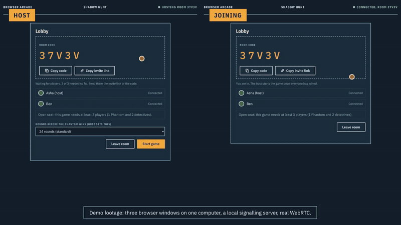
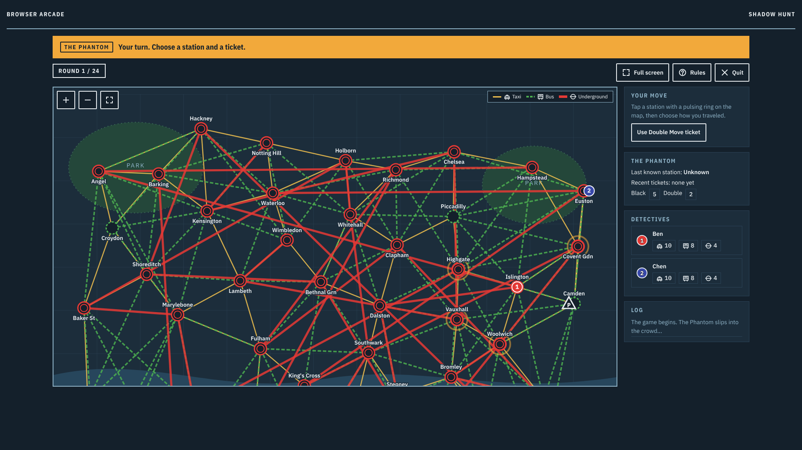
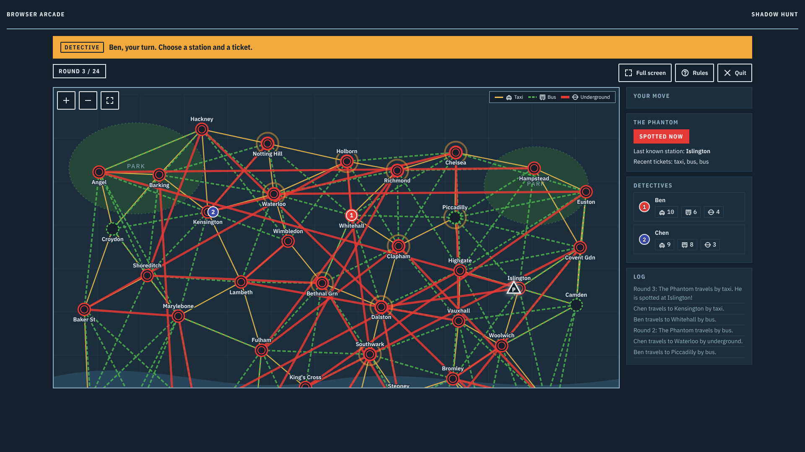
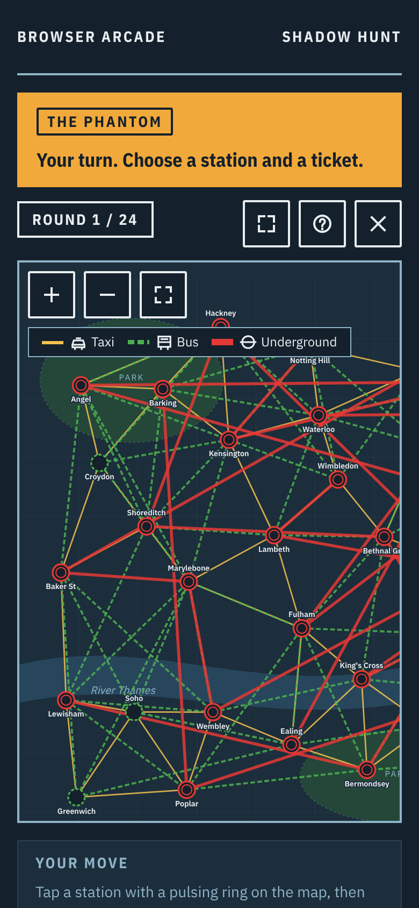
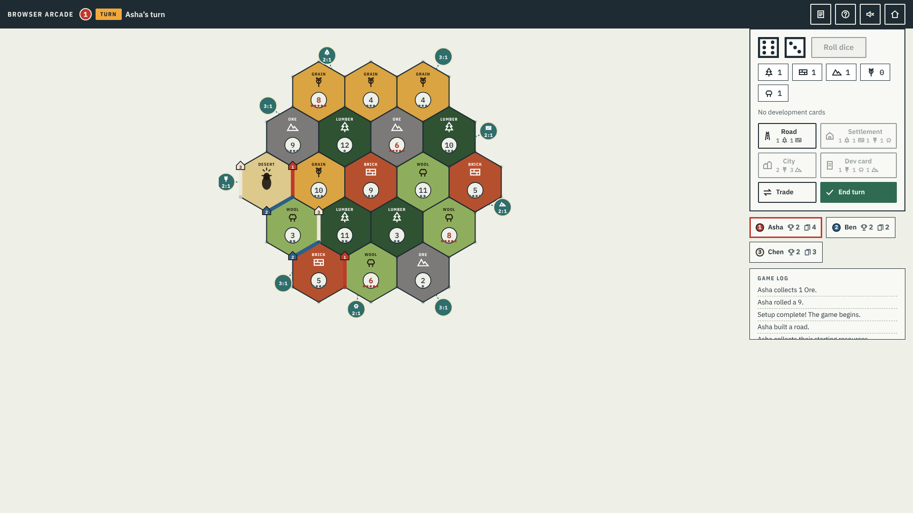
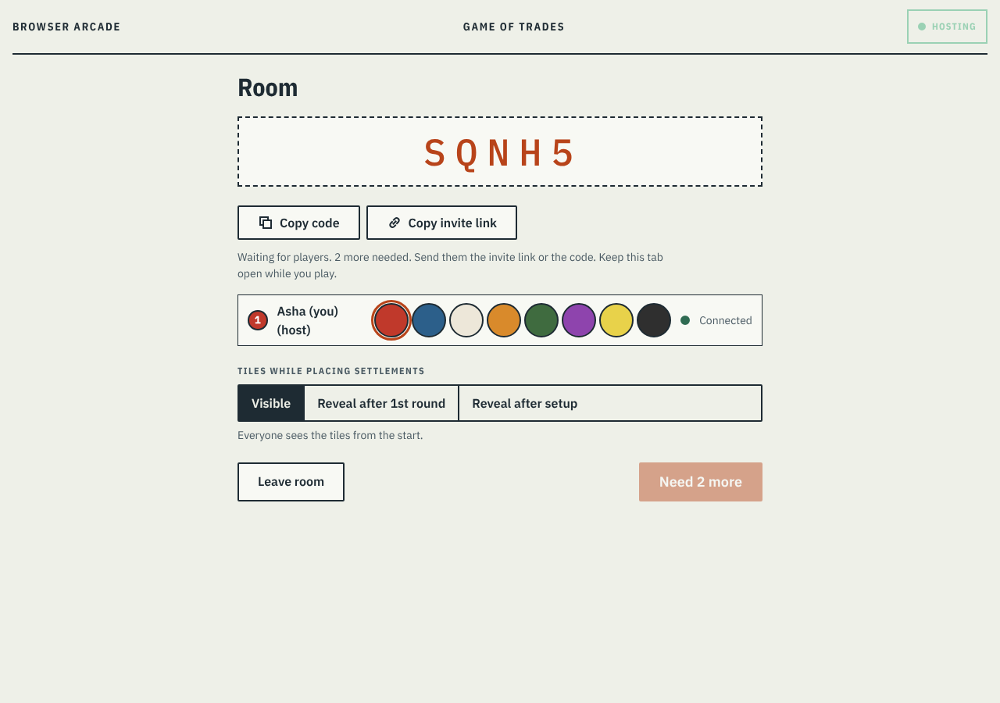
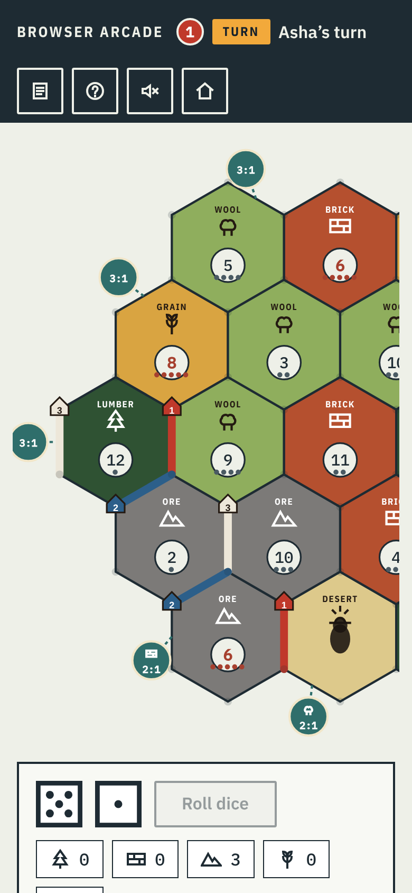
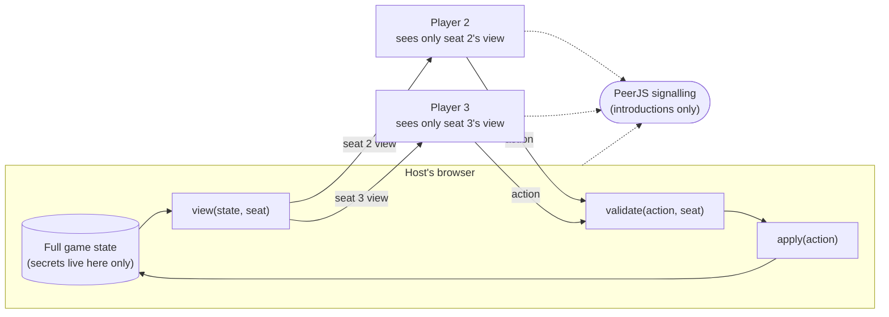

# Browser Arcade

Two board games that run in a browser tab: pass one screen around the table, or open an online room and play from separate devices. No account, no install, no build step.

**Play it: <https://dhairya233.github.io/browser-arcade/>**

[](https://github.com/Dhairya233/browser-arcade/actions/workflows/ci.yml)
[](LICENSE)



## What it is, and why I built it

I started from two single-file games I had written: a hidden-movement chase game and a resource-trading island game. I wanted to find out what it takes to turn single-file toys into something I would be comfortable letting strangers play: rules in modules that can be tested without a browser, online play where each player is only sent what their seat may see, and a design that works on a phone. This repository is the result of that rework. Everything is plain JavaScript with native ES modules.

## Demo video

<!-- To add the video: edit this file on github.com, click here, drag docs/media/browser-arcade-demo-captions.mp4 into the editor, and GitHub inserts a link that plays inline. Put it on the line below. -->

Until the inline player is added, the video is in the repository: [77 s demo with captions](docs/media/browser-arcade-demo-captions.mp4) (or [without captions](docs/media/browser-arcade-demo.mp4), a [vertical 31 s short](docs/media/browser-arcade-short.mp4), and the [script](docs/media/script.md)).

The online scenes in the video are three browser windows on one computer using a local signalling server. They show the real pages and the real PeerJS and WebRTC code, but they are not footage of two devices on different networks. [`docs/media/README.md`](docs/media/README.md) explains exactly what the footage is and how to rebuild it.

## The two games

### Shadow Hunt (3 to 6 players)

One player is **The Phantom**, loose on a city map and hidden. Everyone else is a detective, and the detectives play as a team. Each turn you move along a route by taxi, bus or underground, and you spend a ticket of that type. The Phantom's moves are logged by ticket type only. On rounds 3, 8, 13, 18 and 24 his position is shown for a moment. The detectives win by landing on him; he wins if the round limit (12, 18, 24 or 30, chosen in the lobby) runs out. He also holds black tickets that hide the transport and double-move tickets.

| Board | A reveal round | On a phone |
|---|---|---|
|  |  |  |

On one screen, a pass screen hides the Phantom's moves between turns. Online, the Phantom's seat is the only one that is ever sent his position.

### Game of Trades (3 to 8 players)

Settle an island. Roll the dice, collect resources from the tiles next to your settlements, build roads, settlements and cities, buy development cards, and trade with the other players or the bank (ports give better rates). Longest road and largest army are worth points. The first player to 10 victory points wins. The card names and rules follow the classic island-trading format; see the note on non-affiliation below.

| Board | Online room | On a phone |
|---|---|---|
|  |  |  |

On one screen, each player can set an optional password that hides their hand when the device is passed. That keeps casual peeking away; it is not security (see limitations).

## How multiplayer works

One player's browser is the **host**. It holds the whole game, applies every action, and sends each other player a *view* of the game made for their seat. Players connect to the host directly over WebRTC using [PeerJS](https://peerjs.com/). A small public signalling server only introduces the browsers to each other.



- Each game plugs into the shared netcode (`shared/net/`) through an adapter: `start`, `view`, `validate`, `apply`, plus settings. The netcode knows nothing about the rules.
- The host checks every action before it applies it: it must come from the seat whose turn it is, and the engine must accept it. Anything else is refused and changes nothing.
- A seat is tied to a random token kept in that browser tab. Refreshing the page seats you again automatically. Someone who only knows your *name* cannot take the seat unless the host presses Allow, and the request expires after 60 seconds.
- Rooms use a five-character code, and invite links look like `?room=ABCDE`.

**Honest limits of the networking**

- The host's browser is the server. If the host closes the tab or loses connection, the game ends. A dedicated server would remove that, at the cost of running one.
- A malicious host can see everything, because the host holds the whole game. Host with people you trust.
- Connections use PeerJS's free defaults: a public signalling server, a Google STUN server and a shared community TURN relay. These are free services with no uptime guarantee, and some school, work or mobile networks block peer-to-peer traffic whatever you do. When that happens the page says so after a timeout.
- A player who never comes back can stall a turn or a discard. There is no vote to skip them yet.
- I have tested this over a local PeerJS server and in memory. I have not verified it across real home and mobile networks at scale.

## Security model

What I defend against, and how:

| Threat | What the code does |
|---|---|
| A player reads secrets from their own network traffic | The host sends each seat a per-seat `view`; secrets are removed before sending. Tests read every message on the wire. |
| A player sends a move they should not be able to make | `validate` runs before `apply`: right seat, right turn, legal move, tickets and cards available. Unknown ids and junk payloads are refused without crashing. |
| A player pretends to be another seat | Seat fields in messages are ignored; the seat comes from the connection. Reconnecting needs the secret token. |
| Name-based seat takeover | Needs the host's Allow, expires in 60 s, and kills the old token. |
| Hostile names or payloads | Names are stripped of HTML characters, control, zero-width and text-direction characters and capped at 16 characters. Output is escaped. Oversized, malformed and flooding messages are dropped or throttled. |
| Who plays the Phantom is guessable | The draw uses the browser's secure random generator, not `Math.random`. |

What I do not defend against: a host cheating (see above), someone watching the screen of a shared device, and the local-play passwords, which are stored unencrypted in the browser's localStorage.

## A hidden-information leak I found in my own game and how I fixed it

**What was exploitable.** In my original online Shadow Hunt, the host broadcast the *entire* game state to every player after every move. The Phantom's real position and his black and double ticket counts were in that state. The interface simply did not draw them. I wrote an audit script that plays the original code and looks at what a client receives: in a scripted game, 26 of 26 snapshots that should have hidden the Phantom contained his real position, and his position was already in the state before the first move. Reading the network messages in the browser's developer tools was enough to see where he was.

**The same audit found host trust problems.** The host accepted a detective move to a station that was not a legal destination, and a message naming a player index that does not exist crashed the host.

**The fix.** I moved the rules into a pure engine module, put online play behind the shared netcode, and made the host build a per-seat `view`. The Phantom's seat gets his position and his black and double tickets; every other seat gets only what the rules show (his position on reveal rounds, the ticket types he has used). The host now runs `validate` on every action before `apply`. When the game ends, everything is shown.

**The test that guards it.** `tests/shadow-hunt.net.test.js`, the test named *nobody but the fugitive ever receives his position or secret tickets (whole game, every message)*, plays an online game past the first reveal round, reads every state message delivered to every non-Phantom seat, and asserts that his position is empty except on a reveal round or when the game is over, and that his black and double ticket counts are always empty until then. It also checks the raw frames sent to a detective. Companion tests check setup (you see only your own start), reveal and re-hide, the end of the game, and forged moves. `tests/net.security.test.js` does the same for the shared netcode, including that no token ever appears on the wire.

## Run it locally

You need [Node.js](https://nodejs.org/) 20 or newer. There is nothing to install.

```
git clone https://github.com/Dhairya233/browser-arcade.git
cd browser-arcade
npm start
```

Then open <http://localhost:8780/>. `npm start` runs `tools/serve.mjs`, a small static server with no dependencies that listens on this computer only. Any other static server works too, for example `npx http-server -p 8780` or the VS Code Live Server extension. The pages use ES modules, so opening `index.html` straight from the disk (`file://`) will not work.

To try online play on one computer, open the site in two browser tabs, create a room in one and join with the code in the other. This uses the public PeerJS server, so you need an internet connection.

### Tests

```
npm test
```

This runs Node's built-in test runner on `tests/`: 135 tests, no packages needed, about ten seconds. They cover both rules engines, the netcode (security, reconnects, takeovers, flooding), per-seat views, colour-blind contrast of the palettes, and a fuzz test that plays both games with random legal moves and hostile payloads and checks invariants (for example, Game of Trades card counts never change). Tests run on every push through GitHub Actions.

### Balance check

```
npm run balance          # or: node tools/balance-sim.mjs 1000
```

Plays bot games on the real Shadow Hunt engine and prints win rates by player count and round limit. The bots are simple (random, or "careful" ones that chase or flee by distance), so read it as a rough guide to the rules, not to human play. With careful bots on both sides, detectives win about 10% of 3-player games at 24 rounds and about 49% of 5-player games; 3 players is clearly tilted towards the Phantom.

## Project structure

```
index.html, landing.css       The arcade landing page
games/
  shadow-hunt/                Chase game
    engine.js                 Rules, no DOM: movement, tickets, reveals, win checks
    adapter.js                Plugs the engine into the netcode: views, validation, map
    main.js, look.js          Screens, input, rendering (the only files that touch the DOM)
    icons.js, style.css, index.html
  game-of-trades/             Trading game, same layout (engine, adapter, main, pieces, icons)
shared/
  net/                        Host-authoritative netcode
    host.js, client.js        Room host and joining client
    protocol.js               Message shapes, limits, name cleaning
    transport-peerjs.js       WebRTC through PeerJS
    transport-memory.js       In-memory transport used by tests and scripted demos
    peer-options.js           Where to point at your own signalling or TURN servers
    ids.js                    Room codes and seat tokens (secure random)
  ui/                         Design tokens, shared styles, self-hosted fonts, screen wake lock
vendor/                       PeerJS 1.5.4, unmodified, with its licence
tests/                        Node test runner tests
tools/
  serve.mjs                   Local static server for `npm start`
  balance-sim.mjs             Shadow Hunt balance simulation
  media/                      Scripts that record and build everything in docs/media
docs/media/                   Demo video, short, GIF, screenshots, scripts
.github/workflows/            Tests on every push, GitHub Pages deploy
```

## Design decisions and trade-offs

- **Host-authoritative over WebRTC, no server.** It costs nothing to run and nothing to deploy, so the whole site is static files. The price is that the host is a single point of failure and has to be trusted.
- **Engine apart from the renderer.** Rules are plain functions on plain data, so they run in Node tests, in a fuzz test and in a balance simulation. Making that split is what made the leak findable and the fix testable.
- **Views, not hiding in the interface.** Secrets are removed before they leave the host. The interface never has anything to hide.
- **No build step.** Native ES modules and Node's test runner. The deployed site is the repository files.
- **Colour is never the only cue.** Shadow Hunt marks transport with ring shapes and line styles, Game of Trades numbers every seat, and tests check the palettes for colour-vision contrast.
- **Self-hosted fonts and a vendored PeerJS.** Pages load nothing from a font service. Online play is the one place that contacts outside servers (see notices).
- **One look per game.** Shadow Hunt is the night map sheet, Game of Trades is the day sheet, both from the same design tokens.

## Known limitations

- The host closing the tab ends the game; a malicious host sees everything.
- A player who never returns can stall a turn or discard.
- Free public TURN has no uptime guarantee, and some networks block peer-to-peer play.
- Local-play passwords are stored unencrypted in localStorage and only deter casual peeking.
- Not verified: online play across real internet connections with NAT and TURN, browsers other than Chromium, real phones (it was checked at phone sizes in an emulator), opening via `file://`, and a full walkthrough with a screen reader (an automated accessibility scan passes; that is not the same thing).
- The Shadow Hunt map is one fixed city graph, and 3-player games favour the Phantom.

## Roadmap

- A turn timer and a "skip absent player" vote for the host.
- Real-network testing of online play, then a documented TURN setup of my own.
- Host hand-over, so a game can survive the host leaving.
- More maps for Shadow Hunt, and a catch-up balance pass for 3 players.

## Not affiliated

This is an independent hobby project. It is not affiliated with, endorsed by or connected to the publishers or owners of any commercial board game. Game and character names here (Shadow Hunt, Game of Trades, The Phantom) are my own.

## Licence and third-party notices

[MIT](LICENSE), copyright 2026 Dhairya Shah.

- **PeerJS 1.5.4**, MIT, vendored unmodified in `vendor/`.
- **IBM Plex Sans, Plex Sans Condensed and Plex Mono**, SIL Open Font License 1.1, self-hosted in `shared/ui/fonts/`.
- **Icons and board art** are inline SVG written for this project; nothing third-party.
- **Music** in the demo video is a bed generated by `tools/media/music.py`, so there is nothing to credit. No recorded music is included.
- **External services used by online play** (PeerJS signalling, STUN, TURN) are described in [`THIRD_PARTY_NOTICES.md`](THIRD_PARTY_NOTICES.md).
